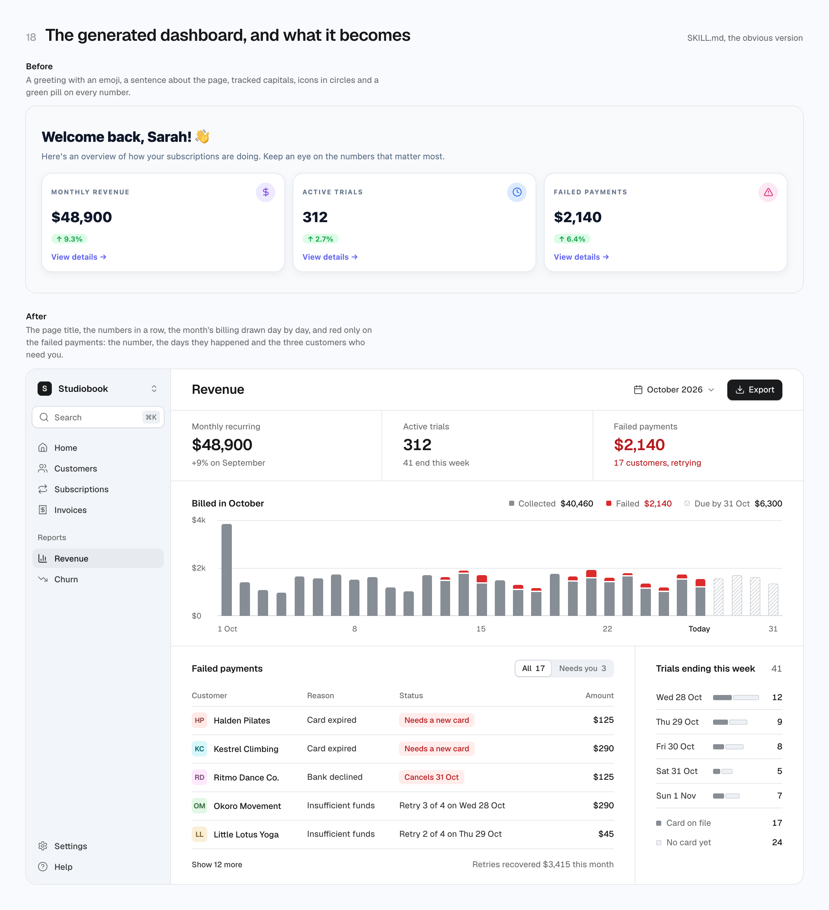
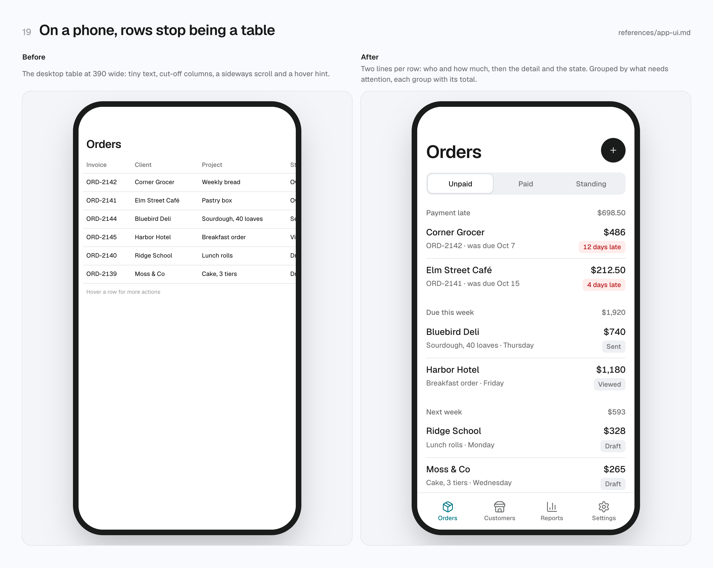
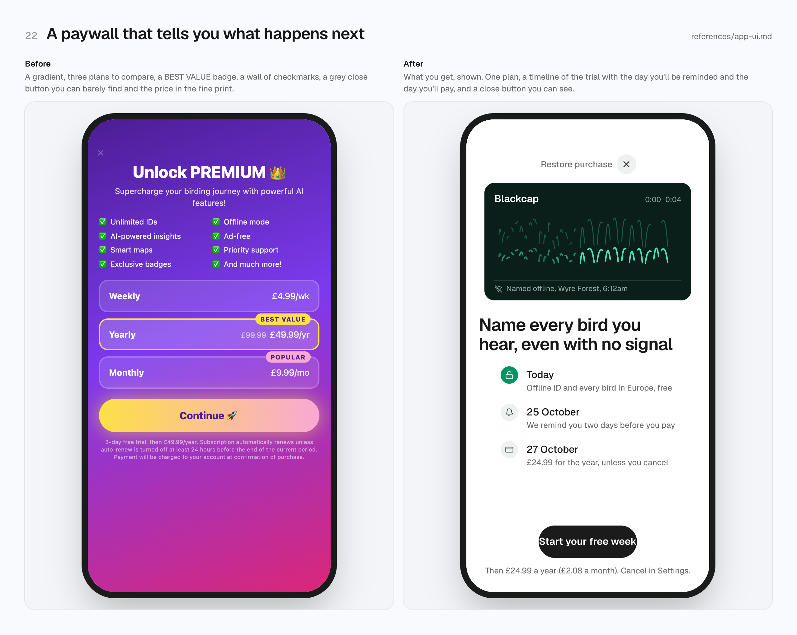

# UI Director

An agent skill that makes your coding agent work like a UI director: interfaces that look
designed, not generated. Calm and precise in dashboards and app screens, bold and memorable on
landing pages, consistent everywhere.

<picture>
  <source media="(prefers-color-scheme: dark)" srcset="gallery/15-dashboard-dark.png">
  
</picture>

**[See all 20 pairs live](https://mannobeats.github.io/hyper-taste/docs/ui-director/)**: every pair is real HTML, with a slider to compare.

AI agents fail at UI in two ways: they add too much (explanations, colors, cards, badges, all-caps
labels, gradients, motion), or they play it safe and ship the house style every model shares,
which people now recognize on sight. UI Director fixes both. The agent studies the product's
world, writes three directions and keeps one in `DESIGN.md` before any code, builds every screen
and state, makes one signature moment, then looks at the result with its own browser at every
width, light and dark, and asks a fresh-eye reviewer before calling it done.

The skill holds outcomes, not machinery: hard rules that hold for every product (contrast,
targets, nothing covered or cut, no invented proof), defaults that may be broken with a reason
from the product's world, and a list of what reads as generated. No templates to copy, so ten
products don't come out as one page.

Works with any stack and any harness: it uses the browser, screenshot and image tools the agent
already has. Native Mac windows follow `mac-design` for their chrome; ui-director directs their
content.

## What's inside

```
skills/ui-director/
├── SKILL.md              direction, build, look, hand over; hard rules, defaults, slop
└── references/
    ├── landing.md        pages that sell: six voices, the first screen, headlines, compositions, staging
    ├── app-ui.md         dashboards, tables, states, controls, responsive, the moments people remember
    ├── mobile.md         phone apps: the answer first, anatomy and sizes, platform conventions
    └── look.md           what to look at, the fresh-eye brief, redesigns and audits
commands/ui-director/     the audit slash command
docs/ui-director/         before/after pairs for humans: live HTML, screenshots, eval fixtures
```

## Install

```bash
npx skills add mannobeats/hyper-taste -g -a claude-code -s ui-director -y
```

```
/plugin marketplace add mannobeats/hyper-taste
/plugin install ui-director@hyper-taste
```

See the [main README](../../README.md#install) for every other way. It works best with the whole
set installed: tokens come from `design-system`, flows and words from `ux-design`.

## Use

The skill triggers on its own for UI work ("build a dashboard for…", "make this landing page look
premium", "clean up this settings screen"). You can also ask for it by name, or run
`/hyper-taste:audit [page] [fix]` to review a page and report (or fix) what's wrong.

## Preview

| | |
|---|---|
|  |  |
|  |  |
|  |  |

## The pairs

Each pair in [`pairs/`](pairs) is two standalone pages, `before.html` and `after.html`, about one
rule from the skill. The "after" pages share [`pairs/tokens.css`](pairs/tokens.css), one token system written as CSS. In the eleven teaching pairs the "before" is
the same page with the same tokens and one fault, so the pair teaches exactly one thing; the older
landing and phone pairs keep a "before" with no system at all.
[`pairs.json`](pairs.json) holds each pair's title, rule and captions, and feeds the live page,
the screenshots and the [evals](../../evals/ui-director).

Photographs from Unsplash: the kitchen in pair 05 by
[Nicolas J Leclercq](https://unsplash.com/photos/KBjDo_QA1lY), the Chapel of Souls in pair 06 by
[Aman Jhalani](https://unsplash.com/photos/ddDNOa4nsLU), the loaf in pair 07 by
[Robert Stump](https://unsplash.com/photos/DNqwLdfo0b8), the motorway in pair 08 by
[Robin Pierre](https://unsplash.com/photos/dPgPoiUIiXk). All names, businesses and numbers in the
pairs are made up.
