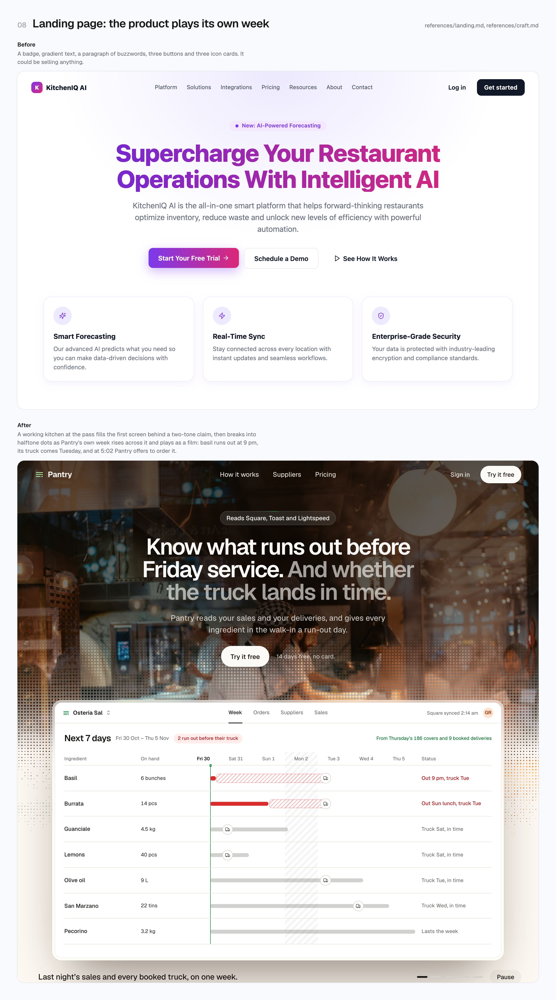
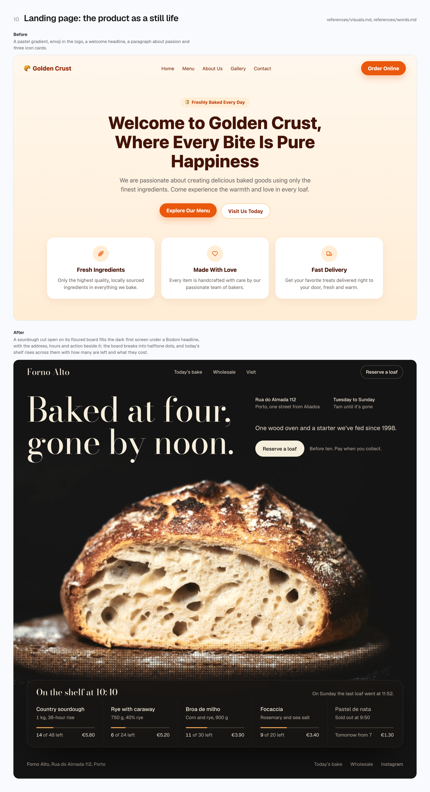
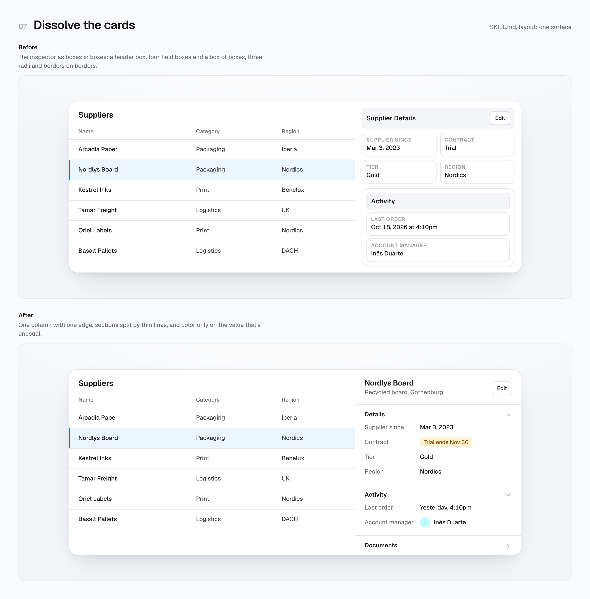
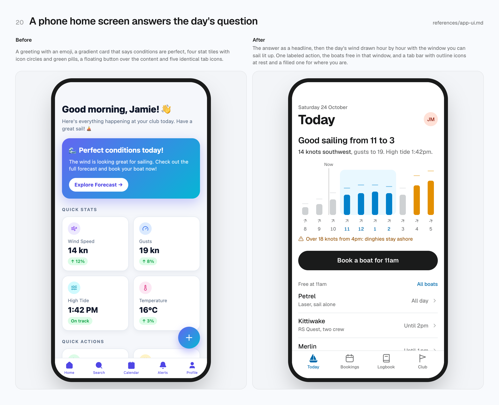

# UI Director

An agent skill that makes your coding agent work like a UI director: interfaces that look
designed, not generated. Calm and precise in dashboards and app screens, bold and memorable on
landing pages, consistent everywhere.

<picture>
  <source media="(prefers-color-scheme: dark)" srcset="gallery/18-dashboard-dark.png">
  
</picture>

**[See all 23 pairs live](https://mannobeats.github.io/hyper-taste/docs/ui-director/)**: every pair is real HTML, with a slider to compare.

AI agents fail at UI in two ways: they add too much (explanations, colors, cards, badges, all-caps
labels, gradients, motion), or they play it safe and ship the house style every model shares,
which people now recognize on sight. UI Director fixes both: the agent writes a direction from
the product's world before any code, builds the whole page, then pushes one signature moment, and
looks at the result with its own browser before calling it done.

The skill ships eight gold examples, each a finished page at the bar it asks for: four landing
pages (a centered promise over a sky drawn in code with the app rising out of it, a dark page
with a machined knob you can turn, a centered light page with a card that leans toward the
pointer, and a night train crossing a viaduct at dusk, where scrolling is the night passing), three dashboards in three shells (sidebar, inset sidebar, top nav), and a running
app's phone screen. Each passes its own check at desktop and phone width. The agent starts from the closest one, copies its structure and replaces its world: tokens,
words, icons, sample data. "A copy that only changes the name is not done." Starting from a
finished page is what makes the result consistent; choosing among different compositions, and a
reviewer asking "could this be any product in its category?", is what keeps it from being the
same page every time. A zero-dependency script looks at the result in headless Chrome and fails
on what is never intentional: a window over the headline, words cut by a crop, a desktop layout
shrunk onto a phone, contrast, slop.

Works with any stack: plain HTML and CSS, Tailwind, shadcn, Bootstrap, MUI, CSS-in-JS, React,
Vue, Svelte, Astro, and native apps (SwiftUI, Flutter, Compose) through the token values. Works
with any harness: it uses the browser, image and 3D tools the agent already has, and never
installs its own.

## What's inside

```
skills/ui-director/
├── SKILL.md              the job router, the loop, craft numbers, layout, "Never" and the obvious version
├── references/           opened for the job at hand
│   ├── landing.md        pages that sell: the direction, the first screen, headlines, compositions, order, conversion
│   ├── voice.md          six voices (type, shape, color, motion), getting the typeface, differing from the gold
│   ├── product-shots.md  the product rebuilt in code: the window, framing, restraint, the film, state grids, phones
│   ├── craft.md          where each move lives in the golds, grounds, rhythm, the last five percent
│   ├── visuals.md        photographs, image generation, layers, scroll scenes, real 3D
│   ├── app-ui.md         dashboards, tables, states, controls, responsive, and the moments people remember
│   ├── mobile.md         phone apps: the answer first, anatomy and sizes, platform conventions, native
│   ├── system.md         the token roles, the knobs, components, DESIGN.md
│   ├── stacks.md         the tokens in Tailwind, shadcn, Bootstrap, MUI and native; auditing a project
│   ├── motion.md         every timing, what to animate, reduced motion
│   └── look.md           the check, what to look at, the fresh-eye brief, redesigns and audits
├── examples/             eight gold pages to start from, built from docs/ui-director/gold (npm run examples)
├── teaching/             fourteen small before and after pairs, for diagnosing one problem
├── scripts/              check.mjs (headless Chrome, no dependencies) and page-check.js
└── fonts/                Geist, Geist Mono and Source Serif 4 (OFL), for when a product has no face
commands/ui-director/     setup, audit and match slash commands for Claude Code
docs/ui-director/         before/after pairs for humans: live HTML, screenshots and evals source
```

## Install

```bash
npx skills add mannobeats/hyper-taste --skill ui-director
```

```
/plugin marketplace add mannobeats/hyper-taste
/plugin install ui-director@hyper-taste
```

See the [main README](../../README.md#install) for every other way.

## Use

The skill triggers on its own for UI work ("build a dashboard for…", "make this landing page look
premium", "clean up this settings screen"). You can also ask for it by name: *"use ui-director"*.

What the agent does:

1. Picks the job (a page that sells, app UI, a phone app, a redesign, an audit, a design
   system) and opens only the files for it.
2. Writes a direction into `DESIGN.md` before any code: the obvious version, three directions
   from the product's world in three different compositions, the pick and the gold example it
   starts from, a signature on the first screen, palette, type and one sample world. App and
   phone screens name the key object, the moments and what needs attention.
3. Writes the tokens in the project's own format (CSS variables, Tailwind, shadcn, Bootstrap,
   MUI, native), or audits an existing project and puts it on tokens.
4. Builds the whole page with real content, then spends its time on the signature and the
   finish: for software, the product rebuilt in code and playing its job as a film; for
   physical things, photographs, layered scenes and 3D.
5. Runs `scripts/check.mjs`, opens every screenshot (desktop and phone, light and dark), puts
   its first screen beside the gold's, asks a fresh-eye reviewer, and fixes what it sees until
   the check passes, two passes at least.

In Claude Code you can also call the modes directly (the prefix is `hyper-taste:` when you
installed the bundle):

```
/ui-director:setup [brand URL]        set up tokens, components and DESIGN.md
/ui-director:audit [page] [fix]       review a page in the browser and report (or fix) what's wrong
/ui-director:match <url>              match the look of a website
```

## Preview

| | |
|---|---|
|  |  |
|  |  |
|  |  |

## The pairs

Each pair in [`pairs/`](pairs) is two standalone pages, `before.html` and `after.html`, about one
rule from the skill. The "after" pages share [`pairs/tokens.css`](pairs/tokens.css), the token
system from `references/system.md` written as CSS. In the fourteen teaching pairs the "before" is
the same page with the same tokens and one fault, so the pair teaches exactly one thing; the older
landing and phone pairs keep a "before" with no system at all.
[`pairs.json`](pairs.json) holds each pair's title, rule and captions, and feeds the live page,
the screenshots and the [evals](../../evals/ui-director).

The pages in [`gold/`](gold) are built into the skill's `examples/`, and the small pairs into
`teaching/`, by `npm run examples`, which points the fonts at the skill, inlines the tokens
into each gold and writes them once for the pairs (`teaching/tokens.css`). Every picture in the gold pages is drawn in code, so the skill ships no photographs. Edit the pages here, never the built
copies. Some of the framing rules, the review brief and several detectors in the check are
adapted from [Stageshow](https://github.com/benjitaylor/skills/tree/main/stageshow) by Benji
Taylor (MIT).

To regenerate the screenshots in [`gallery/`](gallery) after changing a pair (uses your installed
Chrome):

```bash
cd docs/ui-director
npm install
npm run shoot                     # every pair, light and dark
npm run shoot -- 08-landing-product   # one pair
```

Photographs from Unsplash: the kitchen in pair 08 by
[Nicolas J Leclercq](https://unsplash.com/photos/KBjDo_QA1lY), the Chapel of Souls in pair 09 by
[Aman Jhalani](https://unsplash.com/photos/ddDNOa4nsLU), the loaf in pair 10 by
[Robert Stump](https://unsplash.com/photos/DNqwLdfo0b8), the motorway in pair 11 by
[Robin Pierre](https://unsplash.com/photos/dPgPoiUIiXk). All names, businesses and numbers in the
pairs are made up.
