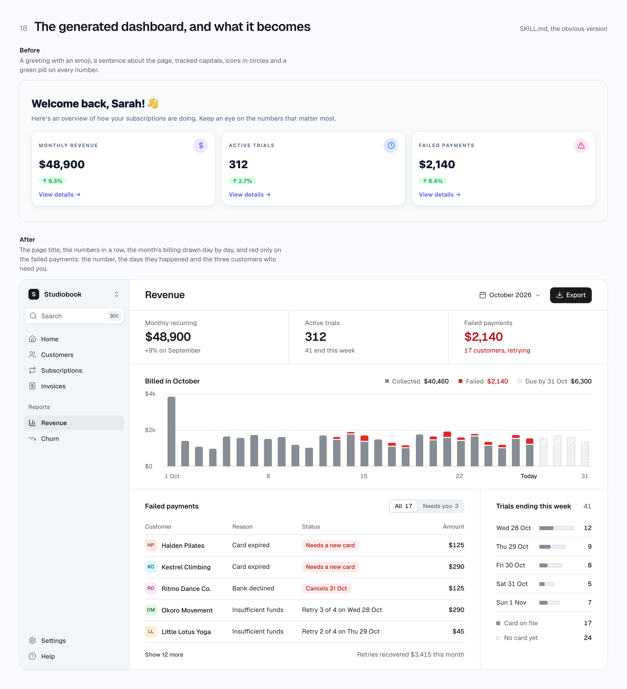
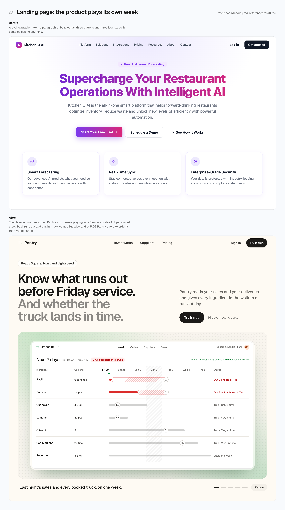
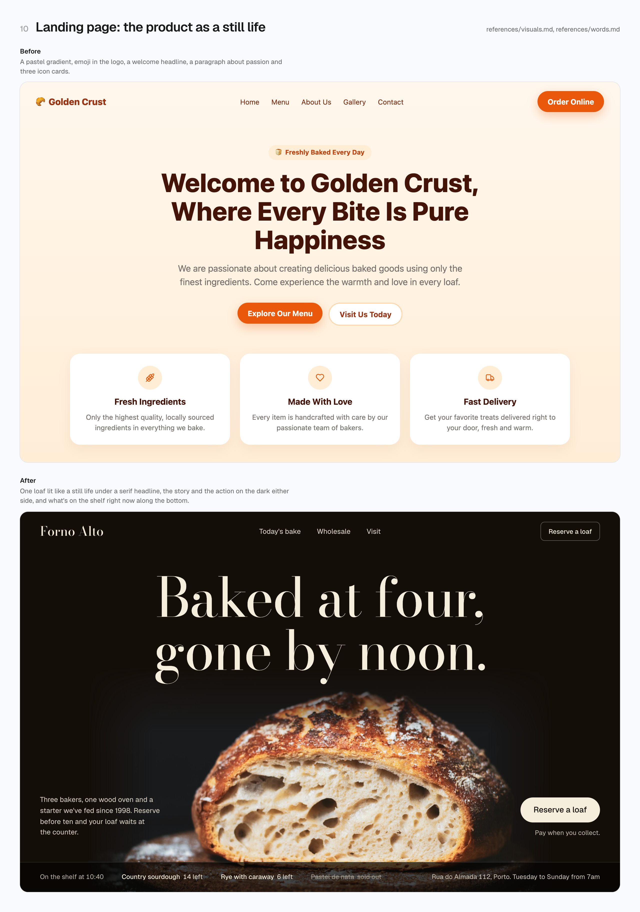
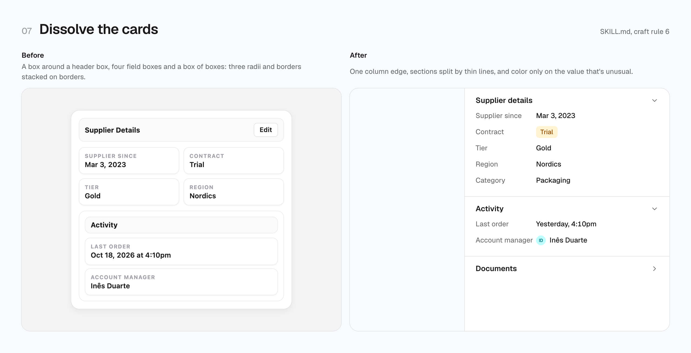
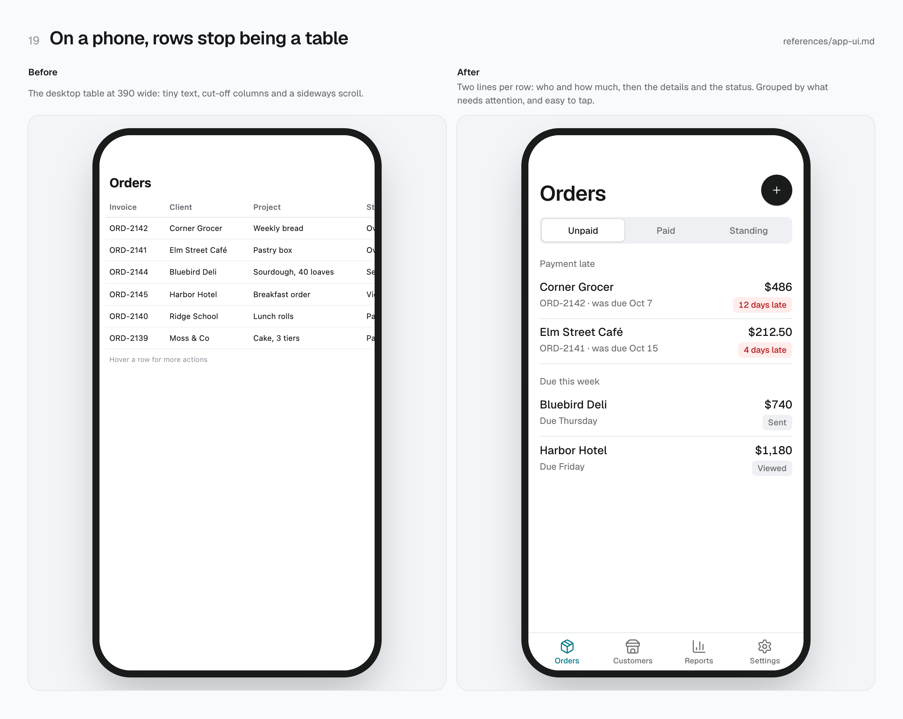
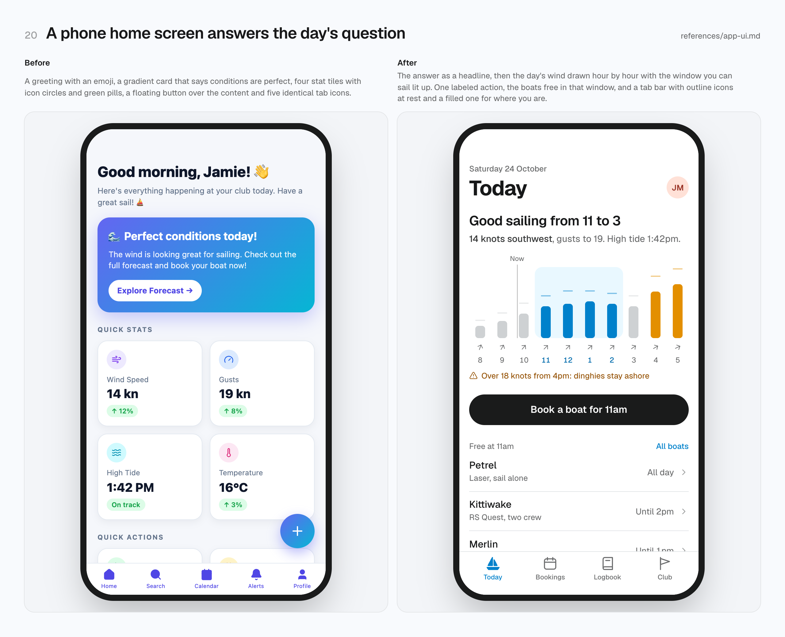
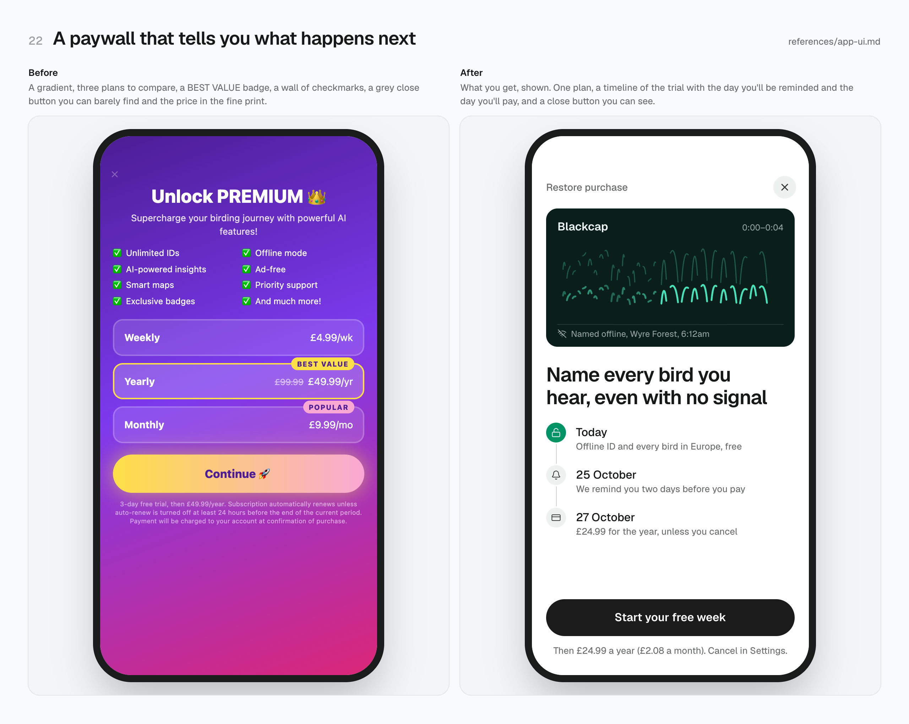

# UI Director

An agent skill that makes your coding agent work like a UI director: interfaces that look
designed, not generated. Calm and precise in dashboards and app screens, bold and memorable on
landing pages, consistent everywhere.

<picture>
  <source media="(prefers-color-scheme: dark)" srcset="gallery/18-dashboard-dark.png">
  
</picture>

**[See all 23 pairs live](https://mannobeats.github.io/hyper-taste/docs/ui-director/)**: every pair is real HTML, with a slider to compare.

AI agents fail at UI in two ways: they add too much (explanations, colors, cards, badges, all-caps
labels, gradients, motion), or they play it safe and ship the house style every model shares,
which people now recognize on sight. UI Director fixes both: the agent writes a direction from
the product's world before any code, builds the whole page, then pushes one signature moment, and
looks at the result with its own browser before calling it done.

There are no example pages and no stylesheet to copy, on purpose. Agents reproduce whatever page
they see, and a shared stylesheet makes every product look alike and clashes with frameworks.
The skill teaches rules, numbers and a token recipe, and the agent writes the tokens in the
project's own format. Every product gets its own page, and every page stays consistent.

Works with any stack: plain HTML and CSS, Tailwind, shadcn, Bootstrap, MUI, CSS-in-JS, React,
Vue, Svelte, Astro, and native apps (SwiftUI, Flutter, Compose) through the token values. Works
with any harness: it uses the browser, image and 3D tools the agent already has, and never
installs its own.

## What's inside

```
skills/ui-director/
├── SKILL.md              the job router, the loop, craft numbers, layout, "Never" and the obvious version
├── references/           opened for the job at hand
│   ├── landing.md        pages that sell: the direction (with a blueprint), grammar, first screen, order, conversion
│   ├── craft.md          the finish: type, chip, buttons, hairlines, the product window, the film, lit plates, the close
│   ├── visuals.md        photographs, image generation, layers, scroll scenes, real 3D
│   ├── app-ui.md         dashboards, tables, states, controls, phones, native, and the moments people remember
│   ├── system.md         token recipe, stack adapters, auditing a project, DESIGN.md
│   ├── words.md          headlines, captions, plain copy, one sample world
│   ├── motion.md         every timing, what to animate, recipes, reduced motion
│   ├── tells.md          reviewing and redesigning
│   └── look.md           which browser, what to check, the page check
└── fonts/                Geist and Geist Mono (OFL), the fallback when a product has no face
commands/ui-director/     setup, audit and match slash commands for Claude Code
docs/ui-director/         before/after pairs for humans: live HTML, screenshots and evals source
```

## Install

```bash
npx skills add mannobeats/hyper-taste --skill ui-director
```

```
/plugin marketplace add mannobeats/hyper-taste
/plugin install ui-director@hyper-taste
```

See the [main README](../../README.md#install) for every other way.

## Use

The skill triggers on its own for UI work ("build a dashboard for…", "make this landing page look
premium", "clean up this settings screen"). You can also ask for it by name: *"use ui-director"*.

What the agent does:

1. Picks the job (a page that sells, app UI, a redesign, an audit, a design system) and opens
   only the files for it.
2. Writes a direction into `DESIGN.md` before any code: the obvious version, one blueprint at
   the bar it's aiming for, three directions from the product's world, the pick, a signature on
   the first screen, palette, type, images and one sample world. App screens name the key
   object, the moments, what needs attention and the shell.
3. Writes the tokens in the project's own format (CSS variables, Tailwind, shadcn, Bootstrap,
   MUI, native), or audits an existing project and puts it on tokens.
4. Builds the whole page with real content, then spends its time on the signature and the
   finish: for software, the product rebuilt in code and playing its job as a film; for
   physical things, photographs, layered scenes and 3D.
5. Looks at the result with the browser its harness provides, at desktop and phone widths, in
   light and dark, runs the page check, and fixes what it sees, two passes at least.

In Claude Code you can also call the modes directly (the prefix is `hyper-taste:` when you
installed the bundle):

```
/ui-director:setup [brand URL]        set up tokens, components and DESIGN.md
/ui-director:audit [page] [fix]       review a page in the browser and report (or fix) what's wrong
/ui-director:match <url>              match the look of a website
```

## Preview

| | |
|---|---|
|  |  |
|  |  |
|  |  |

## The pairs

Each pair in [`pairs/`](pairs) is two standalone pages, `before.html` and `after.html`, about one
rule from the skill. The "after" pages share [`pairs/tokens.css`](pairs/tokens.css), the token
system from `references/system.md` written as CSS; the "before" pages have no system on purpose.
[`pairs.json`](pairs.json) holds each pair's title, rule and captions, and feeds the live page,
the screenshots and the [evals](../../evals/ui-director).

The pairs live here, outside the skill folder, on purpose: agents copy whatever page they're shown.

To regenerate the screenshots in [`gallery/`](gallery) after changing a pair (uses your installed
Chrome):

```bash
cd docs/ui-director
npm install
npm run shoot                     # every pair, light and dark
npm run shoot -- 08-landing-product   # one pair
```

Photograph from Unsplash: the loaf in pair 10 by
[Robert Stump](https://unsplash.com/photos/DNqwLdfo0b8). All names, businesses and numbers in the
pairs are made up.
